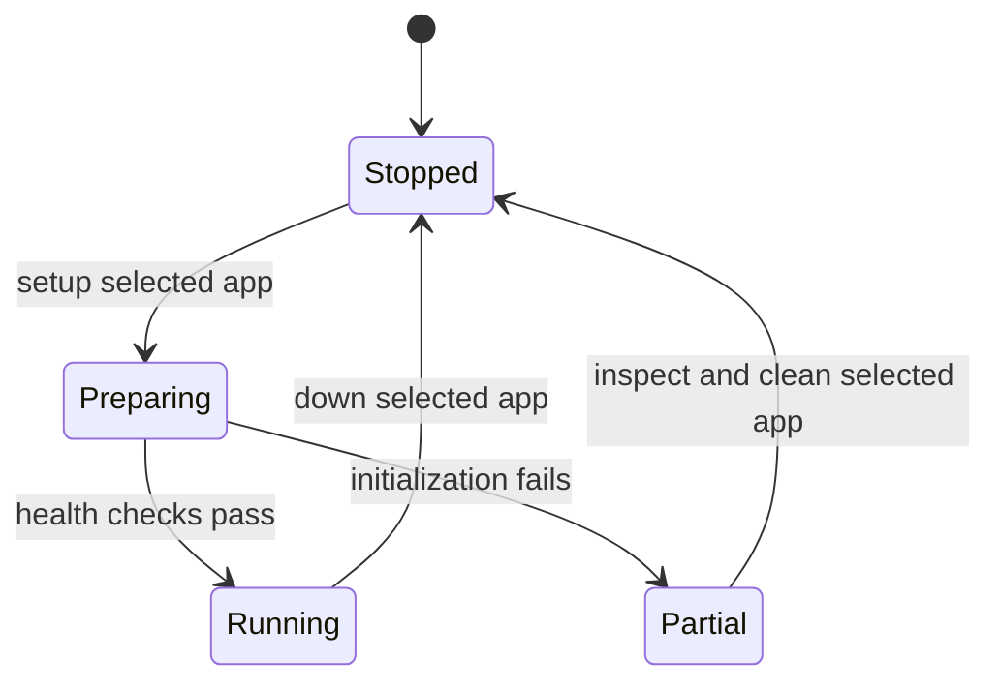

[NAVIGATION](../NAVIGATION.md)

# 🔒 Vòng đời ứng dụng và bảo vệ dữ liệu

## Trình tự xử lý

1. Kiểm tra command, một --app hợp lệ và xác nhận cho thao tác xóa/phục hồi.
2. Với tác vụ tạo tải của Pretix hoặc nhóm PHP/.NET, hiển thị cảnh báo, yêu cầu chấp thuận từng lần gọi và kiểm tra dự phòng host trước khi gọi Docker.
3. Giữ khóa workspace cho thao tác thay đổi tài nguyên.
4. Yêu cầu khóa engine bằng volume điều phối có token sở hữu duy nhất; đọc lại nhãn để xác nhận quyền giữ khóa.
5. Đọc trạng thái container Docker và xác minh ứng dụng, Compose project, thư mục sở hữu. Kiểm tra volume dữ liệu riêng nếu cần.
6. Kiểm tra chính sách RAM trước các bước chuẩn bị image, rồi gọi đúng adapter được chọn.
7. Giữ mã lỗi và giải phóng khóa của chính tác vụ khi kết thúc.

Trạng thái chạy lấy từ Docker. Khi ứng dụng khác còn container hoạt động, launcher từ chối thao tác có thể khởi tạo/chạy adapter mới. Người vận hành down ứng dụng hiện tại trước khi chuyển lựa chọn.



## Các tình huống được bảo vệ

| Tình huống | Xử lý |
| --- | --- |
| Thiếu/sai ID hoặc chọn nhiều ID | Từ chối trước thao tác Docker |
| Ứng dụng cần xác nhận tải nhưng chưa được chấp thuận hoặc host thiếu dự phòng | Dừng trước Docker; chấp thuận không bỏ qua ngưỡng dừng |
| Có ứng dụng khác đang chạy | Yêu cầu down đúng ID; giữ nguyên ứng dụng đó |
| Hai tác vụ thay đổi tài nguyên cùng lúc | Khóa workspace/engine chỉ cho một tác vụ tiếp tục |
| Container thuộc checkout khác | Từ chối tiếp quản; dùng workspace gốc để dừng |
| Volume dữ liệu thiếu nhãn hoặc thuộc workspace khác | Từ chối tái sử dụng/xóa |
| Engine không đọc được trạng thái | Dừng trước bước khởi tạo |
| Setup/start lỗi giữa chừng | Giữ dữ liệu, báo lỗi; tài nguyên còn hoạt động tiếp tục chặn đổi ứng dụng |
| Cấu hình hoặc database Oscar còn ở root | Dừng trước Docker; hướng dẫn chuyển sang apps/oscar trong MIGRATION |
| Dữ liệu đã có nhưng thiếu .env | Yêu cầu phục hồi cấu hình; không tự sinh lại credential cho database cũ |
| Destroy PHP/.NET | Xác minh workspace và app label của volume; chỉ xóa file riêng sau khi cleanup Docker thành công |
| Xóa/phục hồi thiếu --yes | Từ chối trước thay đổi dữ liệu |

Các bảo vệ áp dụng khi dùng launcher. Thao tác Docker trực tiếp của người vận hành có thể thay đổi trạng thái ngoài luồng này; kiểm tra lại bằng status trước khi tiếp tục. Chỉ các đối tượng có nhận diện của workspace hoặc tên project cũ đã biết được kiểm tra; tài nguyên ứng dụng khác không bị tự dừng hoặc prune.

Nếu ứng dụng còn chạy nhưng mất .env, phục hồi đúng cấu hình đã lưu trước khi cleanup. Launcher báo lỗi và không ghi nhận một lần dừng thành công khi chưa thể điều phối tài nguyên.

Nhóm PHP/.NET kiểm tra ownership của database_data, app_data và product_media khi có. Trình khởi tạo PHP chạy bằng one-off container trong khi web đã dừng writers; marker hoàn tất chỉ được ghi sau readiness. Quy trình và phạm vi theo [NATIVE_COMMERCE](NATIVE_COMMERCE.md).

## Khóa và phục hồi sau gián đoạn

Khóa `.runtime/app-operation.lock` bảo vệ workspace. Khóa thuộc namespace trước được xử lý bằng launcher gốc trước khi dùng bộ điều phối hiện hành. Volume `robot-web-operation-lock` phối hợp các launcher trên cùng Docker Engine mà không cần tải image khóa. Nhãn owner là token của tác vụ; khi kết thúc chỉ tác vụ giữ token đó được xóa khóa.

Nếu terminal bị đóng hoặc mất kết nối, khóa có thể còn lại. Trước khi xóa khóa, kiểm tra không có launcher đang thao tác và không có tác vụ init/migrate/Robot đang chạy trên engine. Với engine dùng chung, xác nhận với các người vận hành khác.

```bat
docker volume inspect robot-web-operation-lock
docker ps --filter label=org.robot-web.app
```

Nhãn workspace và owner giúp xác định nguồn tác vụ. Chỉ sau khi xác minh khóa không còn được sử dụng, xóa riêng volume khóa bằng `docker volume rm robot-web-operation-lock` và xóa thư mục `.runtime/app-operation.lock` còn lại tại workspace đó. Không dùng volume prune để xử lý khóa.

Sau phục hồi, dùng status/logs, rồi down đúng --app nếu cần. Danh mục ứng dụng và phạm vi dữ liệu tại [APPS](../APPS.md).

Nếu một one-off task còn chạy sau khi terminal gián đoạn, dùng `docker ps --filter label=org.robot-web.app` và inspect container để đối chiếu app, working_dir và oneoff. Sau khi xác minh đúng tác vụ của workspace mình và không còn người vận hành đang sử dụng, dừng riêng container theo ID rồi tiếp tục kiểm tra trạng thái. Cách này cũng dùng để xử lý bootstrap bị ngắt trước khi .env được tạo; không tạo cấu hình giả để báo cleanup thành công.

## Lỗi đọc nhãn và khóa còn lại trên Windows

Nếu terminal báo lỗi template hoặc không đọc được ownership, thao tác đã dừng trước khi gọi adapter. Lỗi truy vấn metadata và khóa thuộc tác vụ khác là hai trường hợp riêng; xem file task log được thông báo để xác định nguyên nhân. Windows launcher truyền mẫu Docker qua bộ xử lý đối số native để bảo toàn dấu nháy trong tên nhãn.

Một phiên bị lỗi có thể để lại volume khóa. Trước khi thử lại:

1. Dừng launcher bị lỗi và xác nhận không còn tác vụ của workspace trên engine. Với engine dùng chung, xác nhận cùng các người vận hành khác.
2. Chạy các lệnh sau để xem nhãn owner/workspace và container. Đối chiếu cả tác vụ đang chạy lẫn one-off container:

```bat
docker volume inspect robot-web-operation-lock
docker ps -a --filter label=org.robot-web.app
```

3. Khi đã xác minh đây là khóa còn lại của phiên lỗi, không còn launcher/tác vụ sử dụng, xóa riêng khóa đó:

```bat
docker volume rm robot-web-operation-lock
```

4. Nếu còn thư mục .runtime/app-operation.lock của chính workspace sau gián đoạn, xóa riêng thư mục rỗng đó sau cùng bước xác minh, rồi chạy lại lệnh đã yêu cầu.

Không xóa các volume database/media để phục hồi khóa. Nếu metadata vẫn không đọc được, giữ khóa để kiểm tra log và kết nối Docker; không coi lỗi truy vấn là bằng chứng khóa thuộc workspace khác.

## Tham khảo kỹ thuật

[Docker labels](https://docs.docker.com/engine/manage-resources/labels/) và [Docker volume create](https://docs.docker.com/reference/cli/docker/volume/create/) mô tả việc tái sử dụng volume cùng tên; launcher xác minh nhãn owner sau create thay vì coi mã thành công là bằng chứng đã giành khóa.

[NAVIGATION](../NAVIGATION.md)
